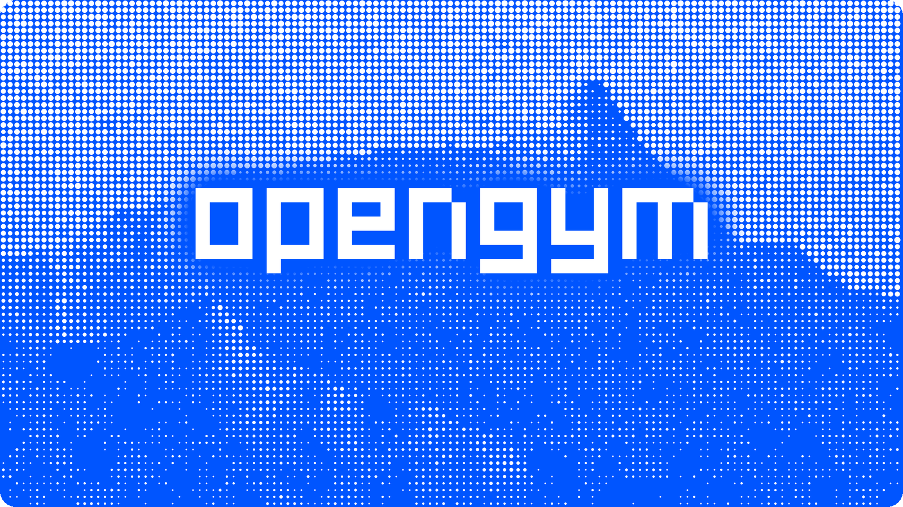

<p align="center">
  
</p>

# OpenGym

Self-hosted gym automation for a single gym or a chain of gyms under one business.

- **Member self-registration** — e-mail + password with OTP verification and explicit data-processing / privacy consent
- **Subscriptions** — sequential membership periods per gym, freezes, cancellations, renewal reminders
- **QR turnstile entry** — a static QR on each turnstile, scanned by the member's phone; the API checks subscription, geofence, anti-passback and account sharing, then opens the gate over WebSocket
- **Staff and roles** — `owner`, `admin`, `staff`, `member`, with admin/staff scoped to their gyms
- **Admin panel** — members, entries, live occupancy, devices, reports, CSV export, audit log
- **Member app** — subscription status, entry history, gate scan, body metrics and calorie calculator (TR/EN)

Online payments, multi-tenant hosting of unrelated businesses and class booking/training/diet features are out of scope. See [`PRD.md`](PRD.md) (Turkish) for requirements and [`ROADMAP.md`](ROADMAP.md) (Turkish) for progress.

## Stack

pnpm + Turborepo monorepo, Node >= 22.

| Package           | Path              | What it is                                                      |
| ----------------- | ----------------- | --------------------------------------------------------------- |
| `@opengym/api`    | `apps/api`        | Express 5 REST API + BetterAuth, MongoDB (native driver), Redis |
| `@opengym/web`    | `apps/web`        | Admin/staff panel — React 19 + Vite + react-router SPA          |
| `@opengym/mobile` | `apps/mobile`     | Member app — Expo SDK 57 / React Native                         |
| `@opengym/shared` | `packages/shared` | Shared TypeScript types                                         |

Turnstile device agents (Node simulator, Raspberry Pi, ESP32) live in [`agents/`](agents/README.md), outside the workspace.

## Getting started

Prerequisites: Node 22+, pnpm 11, Docker.

```bash
pnpm install
cp .env.example .env            # set BETTER_AUTH_SECRET: openssl rand -base64 32
docker compose up -d            # Mongo on 127.0.0.1:27018, Redis on 127.0.0.1:6380
pnpm dev                        # API on :3000, web panel on :5173
```

On first boot the API seeds the chain owner `admin@opengym.local` with password `admin1234` (development only) and forces a password change at first sign-in. With SMTP unset, OTP e-mails are printed to the API console.

Member app:

```bash
pnpm mobile                     # Expo dev server
pnpm mobile:android             # open on an Android device/emulator
```

Turnstile simulator (no hardware needed):

```bash
pnpm sim:setup                  # create simulated devices
pnpm sim                        # connect them to the device gateway
```

Demo data (only for a database whose name ends in `-demo`; it is wiped first):

```bash
MONGODB_URI=mongodb://127.0.0.1:27018/opengym-ui-demo REDIS_URL=redis://127.0.0.1:6380/7 SMTP_HOST= \
  pnpm --filter @opengym/api seed:demo
```

In development, Swagger UI is served at <http://localhost:3000/api/docs> (never in production).

## Commands

```bash
pnpm dev            # api + web in watch mode
pnpm build          # build all packages
pnpm lint           # eslint
pnpm typecheck      # tsc
pnpm test           # Node built-in test runner
pnpm format         # prettier --write
pnpm format:check   # what CI checks
```

Integration tests run only when `TEST_MONGODB_URI` (no database path, e.g. `mongodb://127.0.0.1:27018`) and `TEST_REDIS_URL` are set.

After changing types in `packages/shared`, rebuild it so the apps see the change:

```bash
pnpm --filter @opengym/shared build
```

## Production

The production stack (`docker-compose.prod.yml`) runs Caddy, the API, the web panel, MongoDB and Redis:

```bash
cp .env.production.example .env
docker compose -f docker-compose.prod.yml up -d --build
```

`INITIAL_ADMIN_PASSWORD` is required in production — there is no default. Keep the development and production env files separate; never merge them into one.

- Backups: [`docs/deployment/backup.md`](docs/deployment/backup.md)
- Legal documents (operator-supplied URLs): [`docs/legal/README.md`](docs/legal/README.md)
- Profile photo storage (Cloudflare R2): [`docs/profile-photos-r2.md`](docs/profile-photos-r2.md)

## Documentation

| Document                                                         | Topic                                        |
| ---------------------------------------------------------------- | -------------------------------------------- |
| [`AGENTS.md`](AGENTS.md)                                         | Architecture, conventions, contributor guide |
| [`docs/api-surface.md`](docs/api-surface.md)                     | API endpoints                                |
| [`docs/multi-gym.md`](docs/multi-gym.md)                         | Multi-gym / chain model                      |
| [`docs/member-controls.md`](docs/member-controls.md)             | Ban, freeze, deletion on behalf              |
| [`docs/reports-and-reminders.md`](docs/reports-and-reminders.md) | Reports and renewal reminders                |
| [`docs/openapi.md`](docs/openapi.md)                             | OpenAPI document and Swagger UI              |
| [`agents/README.md`](agents/README.md)                           | Turnstile device protocol and agents         |

## Contributing

CI runs format → lint → typecheck → test → build on Node 22; run the same locally before opening a PR. All code, comments and technical docs are written in English; Turkish UI copy lives only in each client's `tr` translation map. See [`AGENTS.md`](AGENTS.md) for the full conventions.
